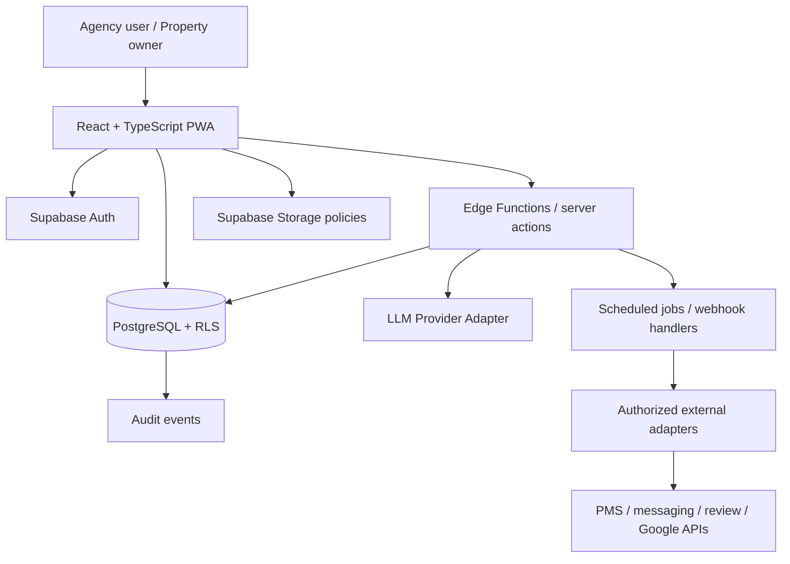

# AtollHost Architecture

## 1. Architectural principles

- Multi-tenant by design; database policies enforce organization and property boundaries.
- PWA-first, responsive, accessible, browser-based delivery.
- Domain modules separated from presentation and external-provider adapters.
- Server-side validation for all privileged operations.
- Human approval and auditable action execution for AI-assisted guest communications.
- Manual/CSV fallback when an external integration is unavailable.
- Honest integration state; no fake success states.

## 2. Logical architecture



## 3. Suggested frontend organization

```text
src/
  app/                 # router, providers, app shell
  components/          # shared accessible UI primitives
  features/
    auth/ organization/ properties/ scanner/ property-brain/
    enquiries/ inbox/ ai-approvals/ tasks/ journeys/
    reviews/ content/ reports/ integrations/ settings/
  lib/                 # supabase client, validators, date/format utilities
  services/            # typed service interfaces and adapters
  types/               # generated database types and domain types
  test/                # fixtures, helpers, policy tests
supabase/
  migrations/
  functions/
```

Keep components presentational where practical. Put business rules in tested domain/service functions, not only in UI event handlers.

## 4. Backend boundaries

- **Browser:** public UI, authenticated calls using the user session, no privileged secrets.
- **Postgres/RLS:** source of truth for records, membership, property assignments, constraints, and tenant access.
- **Edge Functions:** AI provider calls, privileged integrations, webhooks, exports requiring elevated access, token exchange/refresh, and actions that must not expose secrets.
- **Provider adapters:** isolate vendor-specific request/response formats. Every adapter has timeouts, bounded retries, idempotency where possible, schema validation, and observable errors.
- **Jobs:** use a durable queue/table or scheduled function with retry policy and dead-letter/error status. Do not rely on an open browser tab for critical scheduled work.

## 5. Tenant model

Every organization-owned entity carries `organization_id` or joins through a parent whose ownership is enforced. Property-scoped entities carry `property_id`. The database verifies that the property belongs to the same organization. Access decisions are based on authenticated `auth.uid()` membership and active property assignments. The client cannot grant itself access by changing request payloads.

Recommended helpers (implemented and reviewed in SQL): `is_org_member(org_id)`, `has_org_role(org_id, allowed_roles)`, and `can_access_property(property_id)`. Avoid recursive RLS policy designs; use `SECURITY DEFINER` only with a fixed `search_path`, narrow privileges, and explicit tests.

## 6. AI request lifecycle

1. Authenticated user requests a draft for a specific property and conversation.
2. Server verifies user membership, property access, conversation scope, and human-takeover state.
3. Retrieve only current `verified` Property Brain facts permitted for that property.
4. Build a minimal prompt with relevant messages and approved facts; redact unnecessary personal data.
5. Provider returns a structured proposal, not an unbounded action.
6. Validate output against a schema and policy checks. Reject unsupported claims, unverified prices/availability, sensitive actions, and instructions to bypass policy.
7. Save draft, model/provider metadata, source fact IDs, validator result, and prompt/template version.
8. Human edits/approves/rejects. Approval is tied to the exact draft version and expires if content changes.
9. Server executes only the approved action through a configured adapter; verify provider result.
10. Record result and audit event. On timeout/unknown outcome, show `unknown/needs verification`, not success.

## 7. Integration design

Define a common interface for each category (messaging, PMS, reviews, Google Business, content publishing). Store provider-specific credentials encrypted or in a managed secret store, never in ordinary readable client tables. OAuth scopes must be minimal. Integration account state transitions: `not_configured → pending_authorization → connected → degraded/expired/disconnected`. A connection is `connected` only after a successful authenticated test call.

Initial implementation should support manual entry and controlled CSV import/export. Build a live adapter only after API access, partner terms, customer demand, and failure modes are confirmed. Booking.com/Agoda connectivity is not presumed available.

## 8. Observability and operations

Capture structured server logs with request/correlation ID, action category, tenant identifier where safe, duration, and error class. Do not log tokens, secrets, full payment details, or unnecessary message content. Track AI provider latency/failure, job retries, integration health, authorization failures, and action outcomes. Provide an admin-visible operational status without exposing cross-tenant customer data.

## 9. Reliability

- Use idempotency keys for outbound actions where supported.
- Use transactional state changes for approval/execution records.
- Handle webhook duplicate delivery and out-of-order events.
- Retry transient errors with bounded exponential backoff; do not retry permanent validation/auth failures blindly.
- Preserve unresolved external outcomes for human reconciliation.
- Back up the database and test restore procedures.

## 10. Architecture decision gates

Before production, document chosen hosting region, queue/scheduler implementation, AI provider and data terms, attachment retention, email delivery, monitoring/alerting, and backup recovery objectives in `DECISIONS.md`.
