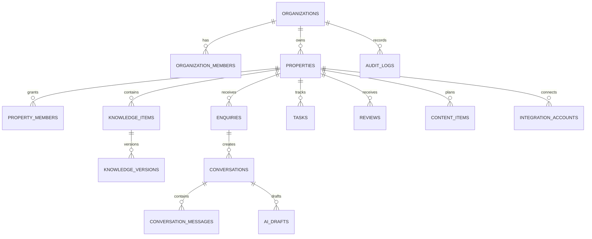

# AtollHost Data Model

## 1. Conventions

- PostgreSQL via Supabase.
- Use UUID primary keys (`gen_random_uuid()` where appropriate), `timestamptz` timestamps in UTC, and `created_at`/`updated_at` consistently.
- Use foreign keys, check constraints, uniqueness constraints, and indexes; do not rely on frontend validation alone.
- Tenant-owned tables include `organization_id` directly or inherit it through a verified parent relation. Property-scoped records include `property_id` where useful for RLS and query performance.
- `created_by`, `updated_by`, `approved_by`, and similar user references are nullable only where system-generated operations require it and must be auditable.
- Use soft deletion/archive only where recovery/audit needs justify it; define retention and purge behavior.
- Store money as integer minor units or `numeric`, never floating-point. Store currency explicitly (MVR for Maldives-facing records unless a transaction specifies otherwise).

## 2. Core entities

### Identity and tenancy
- `profiles`: user profile linked 1:1 to `auth.users`; display name and user preferences, no role trusted from client profile fields.
- `organizations`: agency/customer tenant and status.
- `organization_members`: organization, user, role, status, inviter, invitation/acceptance timestamps.
- `properties`: organization, public name, slug/reference, island/atoll/address, timezone, contact data, status, settings.
- `property_members`: property, user, role/capabilities, status, granted-by metadata.

### Property operations
- `property_rooms` / `room_types`: optional informational room inventory only; not a live PMS inventory ledger.
- `digital_audits`: property, source, scan status, started/completed timestamps, initiator, summary.
- `digital_audit_findings`: audit, category, severity, title, details, source URL/reference, confidence, recommended action, review status.
- `knowledge_categories`: property-scoped taxonomy.
- `knowledge_items`: property, category, key/title, content, status, source, valid-from/expiry, verification metadata, current version.
- `knowledge_versions`: immutable snapshots of knowledge changes, editor, reviewer, reason, timestamps.

### Enquiries and communications
- `guests`: optional contact profile scoped to organization/property policy; avoid unnecessary data collection.
- `enquiries`: property, guest/contact reference, source, topic, status, assigned user, received time, follow-up time, outcome, external reference.
- `conversations`: property, enquiry/guest reference, channel, status, human-takeover state, automation state, assignee, external conversation reference.
- `conversation_messages`: conversation, direction, actor type, text/content metadata, external message reference, delivery status, sent/received timestamps, AI draft metadata, approval reference.
- `message_attachments`: message, storage object reference, MIME type, size, checksum, scan status; storage access must be policy-protected.
- `ai_drafts`: conversation/property, draft version, proposed content/action, model/provider, template version, source knowledge IDs, validation status, approval status, approver, expiry.
- `approvals`: resource/action, exact resource version/hash, requested by, reviewer, decision, reason, timestamps.

### Work and lifecycle
- `tasks`: property, title/description, status, priority, assignee, due date, source workflow, completion details.
- `task_comments`: task, author, comment, created time.
- `guest_journey_events`: property, optional guest/stay/enquiry reference, event type, scheduled/occurred time, status, automation reference.
- `automation_definitions`: organization/property scope, trigger, conditions, actions, enabled flag, approval policy, version.
- `automation_runs`: definition/version, status, idempotency key, started/finished, result/error category, retry count.

### Reviews, content, reports
- `reviews`: property, source, external reference/URL, rating, text, review date, response status.
- `review_responses`: review, draft/current text, status, approver, publication evidence.
- `content_items`: property, channel, content type, text/asset references, schedule time, status, approval and publication metadata.
- `report_exports`: requester, scope, filters, format, storage reference, status, expiry, audit reference.

### Integrations and audit
- `integration_accounts`: organization/property, provider, integration type, status, granted scopes, token reference (not plaintext token), last success/error, configuration metadata with secrets excluded.
- `integration_events`: account, event type, external ID, idempotency key, received/processed timestamps, status, error class.
- `webhook_receipts`: provider, external event ID, signature verification, processing status, dedupe key; retain only needed payload fields.
- `audit_logs`: actor, organization/property, action, resource type/ID, timestamp, request/correlation ID, outcome, redacted metadata.
- `notifications`: recipient, scope, type, read state, action link/reference, timestamps.

### Compliance support (not automatic filing)
- `tax_profiles`: property tax settings and source/verification date.
- `tax_transactions`: manually imported or verified transaction records with currency, tax category/rate, amounts, source reference, and reconciliation state.
- `green_tax_records`: relevant stay/guest-night amounts and source details where applicable.
- `government_records`: optional records for manually tracked submissions/receipts with status and reference; never imply a submission occurred without verified evidence.

## 3. Relationship outline

## 4. Required integrity rules

- A `property_id` must belong to the same `organization_id` on any record that stores both.
- A conversation's enquiry/property/organization references must agree.
- Approval is valid only for the exact version/hash of the draft being executed. Any edit invalidates prior approval.
- `connected` integration state requires a verified health check; successful action state requires provider evidence.
- `verified` knowledge requires reviewer and verification time; expired knowledge is not eligible for AI grounding.
- `human_takeover = true` must block automation execution for that conversation.
- Use idempotency keys for external action jobs and webhook receipts.
- Prevent duplicate memberships, duplicate provider external IDs within scope, and invalid state transitions.
- Use CHECK constraints for enums/status values or PostgreSQL enum types where migrations are manageable.

## 5. RLS policy model

1. Enable RLS on every exposed tenant-owned table and storage bucket.
2. Default deny; add explicit policies for SELECT/INSERT/UPDATE/DELETE.
3. Agency members see organization data only when active members; role capabilities limit writes.
4. Property members see only assigned properties and only their allowed capabilities.
5. Owners must not read agency-wide data or another property.
6. Writes validate ownership and parent relationships in SQL, not only request payloads.
7. Server-side service-role use must be narrow, logged, and inaccessible to the browser.
8. Add negative tests for every table: user A cannot read/write tenant B; owner A cannot access property B; revoked user loses access promptly.

## 6. Indexes

Index foreign keys and common filters: `(organization_id, created_at)`, `(property_id, status)`, `(assignee_id, status, due_at)`, `(conversation_id, created_at)`, `(property_id, status, updated_at)` for knowledge, `(integration_account_id, status, created_at)` for events, and unique idempotency/external reference constraints. Add full-text/trigram indexes only after query patterns are measured. Avoid indexing sensitive data without a need.

## 7. Retention and privacy

Define retention by data category in `PRIVACY.md` and the operating agreement before production. Support deletion/export workflows where legally required. Audit logs may need longer retention than message bodies, but should contain minimal redacted metadata. Never use real guest PII in tests or seed fixtures.

## 8. Migration policy

Migrations are forward-only in production unless a reviewed rollback is safe. Never edit a migration already applied to a shared environment; create a new migration. Review SQL, RLS, indexes, locks, and data backfills before production execution. Regenerate typed database definitions after schema changes.
